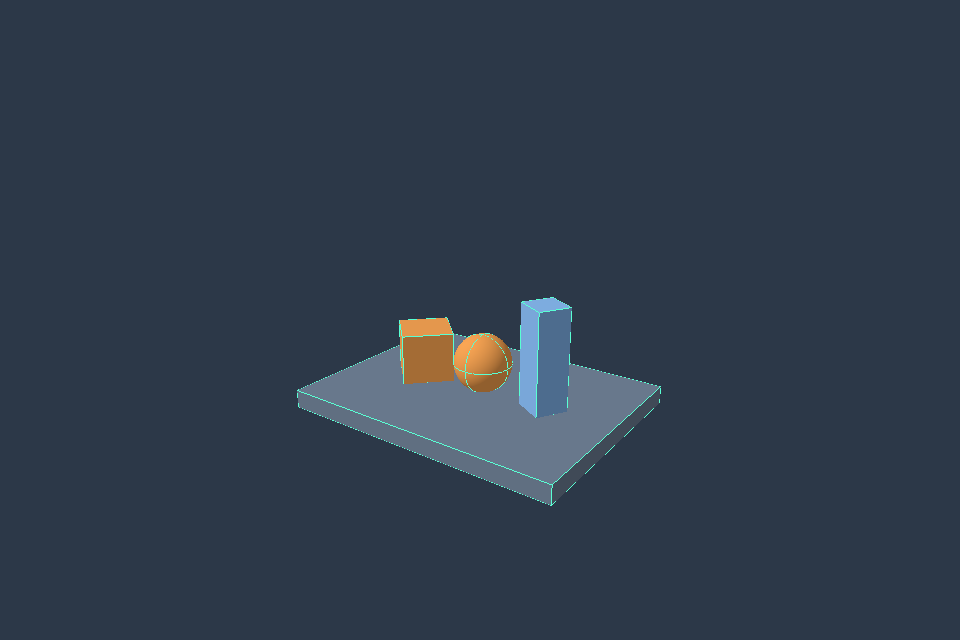

# TomoEngine

**AI가 제작·검증할 수 있는 크로스플랫폼 Rust 3D 게임엔진**을 목표로 합니다.
그 안의 Tomo Physics는 Jolt Physics를 C++ 바인딩 없이 Rust로 직접 이식하는
독립 프로젝트로 유지합니다.

> 현재 구현은 **초기 primitive 물리 런타임 + AI용 장면 도구 + GPU 이미지 캡처**입니다.
> 대화형 게임 창, GLB/스키닝, Tripo 연동, 자율 AI 에이전트, 모바일/콘솔 게임 빌드는
> 아직 없습니다. Jolt 전체 기능·수치·성능 동등성도 아직 달성하지 않았습니다.

## 시작할 문서

- [최종 목표와 큰 하위 목표](docs/PROJECT.md)
- [구조와 의존성·보안 경계](docs/ARCHITECTURE.md)
- [단계별 완료 기준과 다음 작업](docs/ROADMAP.md)
- [실제로 실행 가능한 CLI](docs/CLI.md)
- [Primitive 렌더러와 캡처 검증](docs/RENDERING.md)
- [별도 유지하는 Jolt 이식 현황](docs/PORTING.md)

## 현재 구조

```text
crates/
  tomo-physics/     기존 독립 물리 코어: 외부 Cargo 의존성 0
  tomo-scene/       버전 있는 JSON 장면·검증·문서 patch
  tomo-runtime/     장면 → physics, 고정 tick, 상태·검사 보고
  tomo-render/      snapshot → 구·상자, 카메라·깊이·조명·충돌체 표시·PNG
 tools/
  tomo-cli/        AI/사람이 호출하는 Rust tomo 명령
schemas/           Scene/Patch/View v1 구조 명세
examples/          낙하 장면, 의도적 실패 장면, 수정 요청
scripts/           의존성·계층 정책 검사
```

렌더러는 runtime snapshot을 읽으며 물리 상태를 변경하지 않습니다. 에셋 계층은 후속 작업입니다.

## 시작하기

물리 PR #1과 게임엔진 기반 PR #3을 소유자 요청에 따라 `main`에 통합했습니다.
현재 개발 기준은 `main`입니다.

```sh
git clone https://github.com/Dokpamo/TomoEngine.git
cd TomoEngine
cargo fetch --locked
cargo run -q -p tomo-cli --locked --offline -- capabilities
cargo run -q -p tomo-cli --locked --offline -- scene validate examples/scenes/falling_box.scene.json
cargo run -q -p tomo-cli --locked --offline -- run examples/scenes/falling_box.scene.json --ticks 600
```

Rustup과 `rust-toolchain.toml`의 Rust 1.85.0이 필요합니다. 생성 서비스 API 키는 필요 없습니다.
JSON 라이브러리의 최초 다운로드 이후 Cargo offline 실행이 가능합니다.

GPU 캡처는 선택 기능입니다. 새 파일 경로로 저장합니다.

```sh
cargo run -q -p tomo-cli --features render --locked --offline -- capture examples/scenes/primitives.scene.json --ticks 0 --output primitives.png --colliders
```



이 이미지는 `docs/validation/m2-metal.json`에 기록된 실제 Apple M4 / Metal 실행 결과입니다.

## 첫 구현이 하는 일

엄격한 JSON 파싱 → 단위/ID/수치/참조 검사 → 실제 물리 world 구성 → 고정 tick 실행 →
정렬된 위치/회전/속도/sleep 상태와 최종 위치·속도 검사 결과를 JSON으로 반환합니다.

낙하 예제는 높이 5의 상자가 실제 정적 상자 바닥에 충돌해 멈추는지 검사합니다.
바닥 없는 실패 예제는 검사 실패/종료 코드 1을 확인합니다. 저장된 결과를 재생하지 않습니다.
scene patch는 revision을 검사하고 전체 후보를 검증한 뒤 새 JSON을 출력합니다.
원본 파일을 수정하지 않으며 실행 중 physics rollback 기능으로 오해하면 안 됩니다.

## 기존 Physics의 범위

구·회전 상자, Static/Kinematic/Dynamic, 질량·관성, 힘·토크·충격량, 접촉·마찰·반발,
수면·깨우기, 거리 관절·스프링, 센서/이벤트/ray가 있는 초기 단일 스레드 런타임입니다.
일부 수치 커널은 Jolt 소스 기반이고 primitive 충돌/공간 탐색/조립에는 자체 구현이 있습니다.
GJK/EPA, 전체 형상, CCD, Jolt 병렬 Job System, 전체 관절·캐릭터·차량·soft bodies 등과
원본 differential/performance/determinism 검증은 남아 있습니다. 이슈 #2에서 별도 추적합니다.

## 검증 및 지원 표기

```sh
cargo test --workspace --locked --offline
cargo test --workspace --all-features --release --locked --offline
cargo fmt --all -- --check
cargo clippy --workspace --all-targets --all-features --locked --offline -- -D warnings
python3 scripts/check-policy.py
```

완료 여부는 최신 커밋의 실제 [Actions](https://github.com/Dokpamo/TomoEngine/actions)
결과를 확인해야 합니다. Headless CI가 성공해도 GPU 렌더링/모바일/콘솔 지원을 증명하지 않습니다.
별도 `gpu-capture` job은 소프트웨어 Vulkan에서 실제 픽셀·깊이·이동·회전·PNG·CLI 검사를 실행합니다.

## 라이선스

MIT. Jolt 기준 `v5.6.0` / `e77f175595e64cb44218cc9d9d56fc365ad0e36a`.
원저작권 고지는 LICENSE와 LICENSES/Jolt-MIT.txt, foundation 추적은 upstream/jolt.toml에 있습니다.
공식 Jolt와 별개인 프로젝트입니다. Physics는 여전히 무바인딩·무FFI·외부 의존성 0이며,
serde/serde_json은 상위 데이터/도구 계층, wgpu와 GPU/OS 연동은 렌더러 계층에서 사용합니다.
의존성 선택과 검토 범위는 docs/RENDERING.md 및 scripts/reviewed-dependencies.json에 기록합니다.
