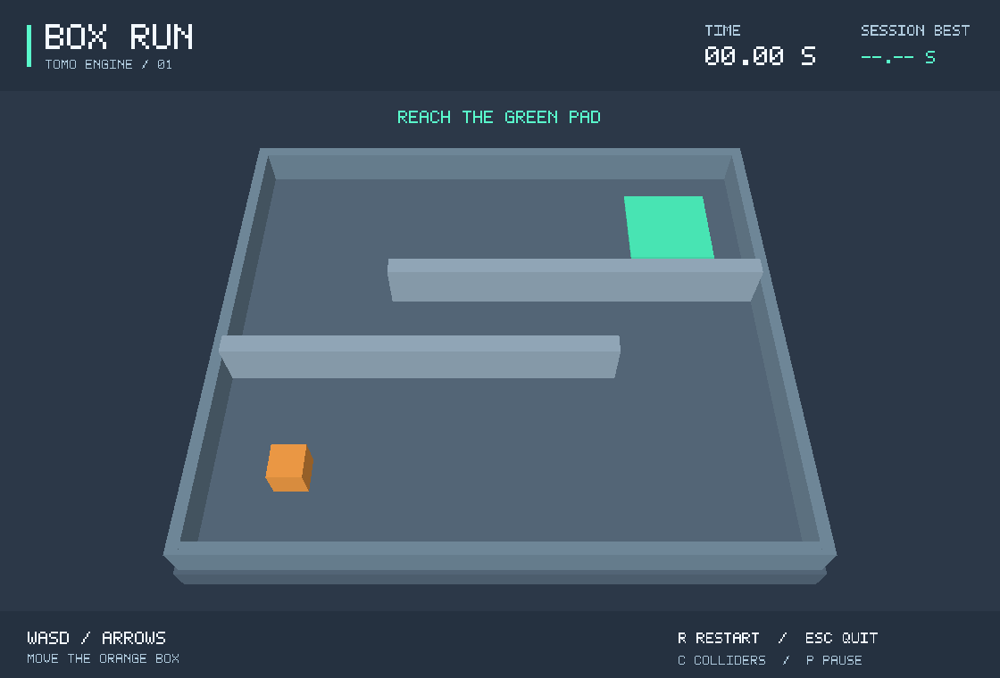

# Box Run: 직접 플레이하는 첫 게임

주황색 상자를 움직여 두 벽을 돌아 초록색 목적지 안으로 들어가는 한 스테이지 게임이다.
실제 `tomo-physics` dynamic 상자와 static 바닥·벽을 사용한다. 위치를 이동 경로로 덮어쓰거나
미리 저장한 애니메이션을 재생하지 않는다. 외부 에셋, API 키, 서버 연결은 필요 없다.

## 실행

```sh
cargo fetch --locked
cargo run -p tomo-play --release --locked --offline
```

게임 창이 열리고 처음 이동할 때 타이머가 시작된다. 방향키 또는 **WASD**로 이동한다.
W/위는 화면 위쪽(-Z), D/오른쪽은 +X다. 키를 놓으면 수평 이동을 멈추며, 대각선 속도는
직선과 같다. 목적지 안에 상자가 충분히 들어가면 `YOU WIN`과 기록이 표시된다.

| 키 | 동작 |
| --- | --- |
| WASD / 방향키 | 상자 이동 |
| R | 시작 위치에서 새 게임, 이번 실행의 최고 기록 유지 |
| P | 일시정지 / 계속 |
| C | 충돌체 표시 켜기 / 끄기 |
| Escape / 창 닫기 | 종료 |

창이 포커스를 잃거나 가려지거나 최소화되면 진행과 입력을 멈춘다. 복귀 시 눌려 있던
키를 지워서 의도하지 않은 이동을 방지한다. 크기 변경과 Retina 배율을 처리한다.
최고 기록은 메모리에만 있으며 앱 종료 시 사라진다. 실패 제한 시간이나 목숨은 없다.



macOS에서 로컬 앱으로 묶으려면:

```sh
python3 scripts/package-macos.py
open "target/Box Run.app"
```

번들은 현재 Mac 아키텍처의 release 바이너리와 라이선스를 포함한다. 외부 배포용
코드 서명·공증·설치 프로그램은 아직 없다. 개발 빌드는 `--debug`를 붙인다.
Windows/Linux에서도 Cargo 명령으로 빌드한다. Linux 창에는 X11 또는 Wayland와
xkbcommon 런타임, Vulkan 드라이버가 필요하다. macOS는 Metal, Windows는 DX12 경로다.
라이브러리의 지원 가능성과 실제 기기 검증은 구분한다.

## 실행 구조

- `examples/scenes/box_run.scene.json`: 바이너리에 포함되는 Scene v1. 바닥, 벽, 목적지 sensor, player.
- `crates/tomo-game/src/lib.rs`: 창 없이도 동작하는 게임 상태·속도 입력·목적지 판정·재시작.
- `tools/tomo-play/src/desktop.rs`: winit 창, 키보드, 포커스, bounded accumulator, resize, 종료.
- `tools/tomo-play/src/view.rs`: 카메라, body별 색, 타이머·조작 안내·완료 HUD.
- `tomo-render::WindowRenderer`: 지속 GPU 장치/파이프라인/정점 버퍼, surface와 깊이 버퍼.
- `tomo-runtime::step`/`set_body_velocity`: scene ID를 통한 실제 물리 조작. physics 소스는 변경하지 않았다.

고정 tick은 1/60초다. 상자는 4m/s를 목표로 하는 arcade velocity controller를 쓰고,
중력과 충돌 반응은 physics가 처리한다. 작은 angular servo로 상자가 원래 자세로 돌아온다.
게임은 상자 bounding sphere가 목적지의 수평 경계 안에 완전히 들어왔는지 보수적으로 판정한다.
도착하면 해당 world를 멈춘다. R은 문서에서 새 world를 만들며 물리 checkpoint 복구가 아니다.

한 프레임에 최대 8 tick만 따라잡고 초과 지연은 버린다. 타이머는 실제 수행한 simulation tick
기준이므로 매우 느린 기기에서 wall clock과 달라질 수 있다. 대화형 `Runtime::step`에는 CLI의
3600 tick 제한을 적용하지 않는다. `Runtime::run`의 기존 누적 tick/work 제한과 수치 실패 시
fail-stop은 유지한다. 일반 scene entity/ECS, visual asset, 게임 SDK로 확장한 것은 아니다.
색과 HUD는 별도의 읽기 전용 `FrameStyle`에 두어 physics scene에 GPU 데이터를 넣지 않는다.

## 입력 재현과 자동 검사

```sh
cargo run -q -p tomo-play --locked --offline -- --replay examples/replays/box_run_win.replay.json
cargo run -q -p tomo-play --locked --offline -- --replay examples/replays/box_run_win.replay.json --capture new-win.png
cargo run -q -p tomo-play --locked --offline -- --capture new-start.png
cargo run -q -p tomo-play --locked --offline -- --smoke-test
```

replay는 창 없이 동일한 Game/controller/physics로 새 게임을 실행한다. GPU는 `--capture`가
있을 때만 초기화한다. Scene과 달리 입력 JSON은 `schemas/replay-v1.schema.json`을 따르며,
1 MiB / 1024 segment / 전체 36000 tick / body 수 제곱 × tick <= 5,000,000 제한을 먼저 검증한다. unknown 필드·버전·0 tick은 오류다.
한 segment는 up/down/left/right 상태를 N tick 유지한다. 예제는 514 tick(약 8.57초)에 도착한다.
성공한 world는 더 진행하지 않으므로 남은 입력 segment가 있어도 최종 tick은 도착 tick이다.
동일 빌드에서 동일 입력을 비교하며, 모든 플랫폼의 bit 단위 동일성을 보장하지 않는다.

stdout은 JSON이다. 종료 코드 0은 정상 종료 또는 기대와 같은 replay 결과, 1은 기대한 승리
상태와 불일치, 2는 입력 오류, 3은 GPU/창/실행/출력 오류다. 캡처는 새 경로만 생성하고 기존
파일을 덮어쓰지 않는다. GPU 오류를 빈 성공 이미지로 바꾸지 않는다.

`--smoke-test`는 실제 창을 열어 고정 입력으로 이동하고 크기 변경 후 120회 surface present를
확인한 뒤 종료한다. 이동·resize 실패나 조기 종료·30초 초과는 오류다. OS 키보드 입력 자체를
검사하는 테스트는 아니며, Linux CI에서는 Xvfb/Vulkan으로 실행한다.

```sh
cargo test -p tomo-game -p tomo-play --locked --offline
cargo test -p tomo-play --locked --offline -- --include-ignored
```

기본 검사는 이동·정지·벽 충돌·대각선·승리·재시작·입력 재현·CLI 제한 이후 게임 수명·프레임
예산·오류 종료 코드를 다룬다. ignored GPU 검사는 실제 시작/목적지 픽셀, 완료 HUD,
PNG와 같은 tick의 snapshot, 기존 파일 보존을 검사하며 GPU CI에서 명시적으로 실행한다.

2026-10-10 로컬 Apple M4/macOS에서 Metal 창을 열어 방향키와 WASD로 직접 목적지에 도착,
P 일시정지, R 재시작 및 최고 기록 유지, C 충돌체, 창 확대, Escape 종료를 확인했다.
PNG/JSON 증거는 `images/box-run*.png`, `validation/box-run*.json`이다.
Linux 창은 최신 CI의 `gpu-capture` 결과로 확인한다. Windows DX12 실기기 창과
모바일·게임패드·오디오·영구 저장은 이번 검증 범위에 포함하지 않는다.

## 만든 프로젝트 실행

에디터/CLI가 저장한 프로젝트는 `tomo-play --project DIRECTORY`로 실행한다.
`--replay`나 `--capture`보다 앞에 `--project DIRECTORY`를 지정한다. Scene과 game의
player/goal/speed 설정을 사용하고 R은 같은 프로젝트의 초기 장면으로 재시작한다.
폴더·문서 구조와 현재 템플릿 제약은 [EDITOR.md](EDITOR.md)를 따른다.
